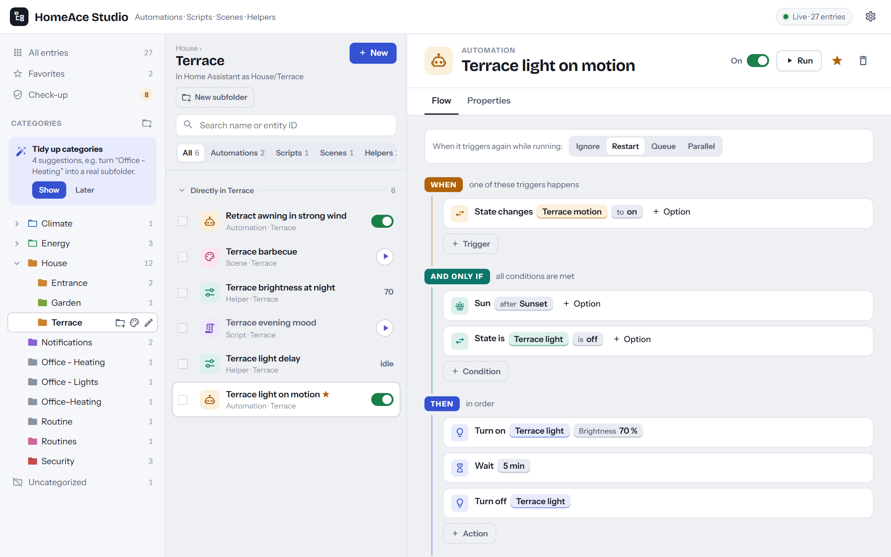
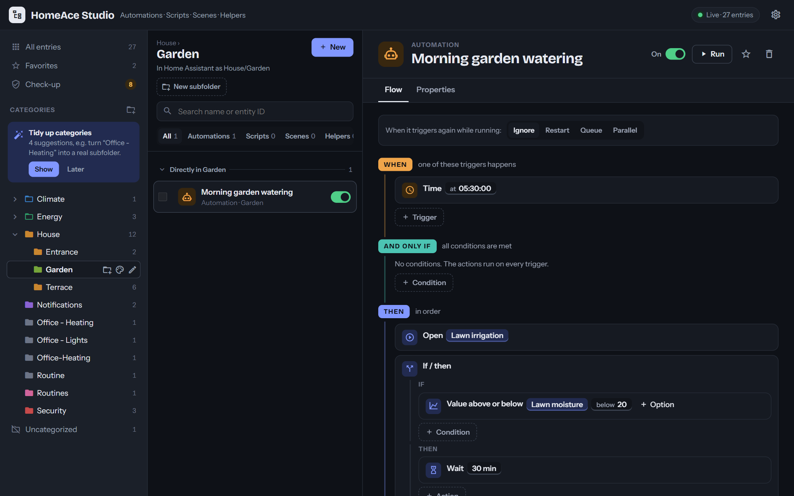
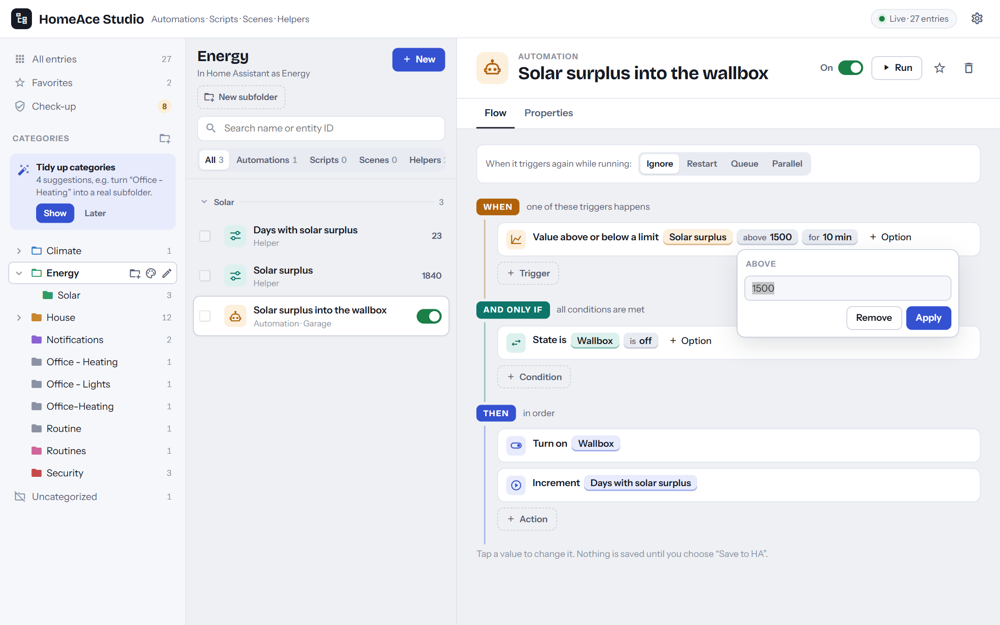
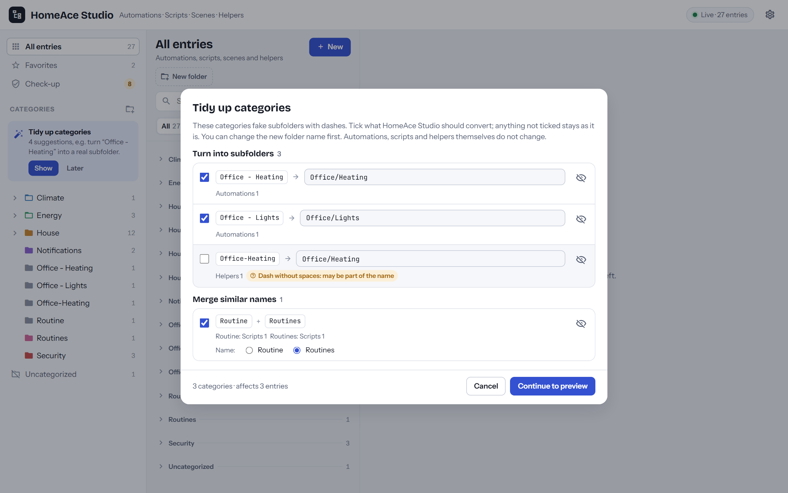
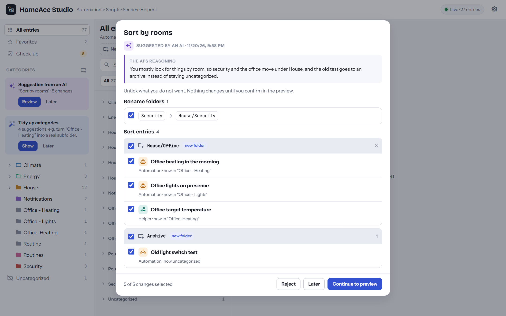
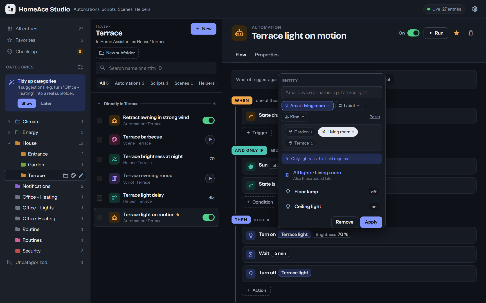
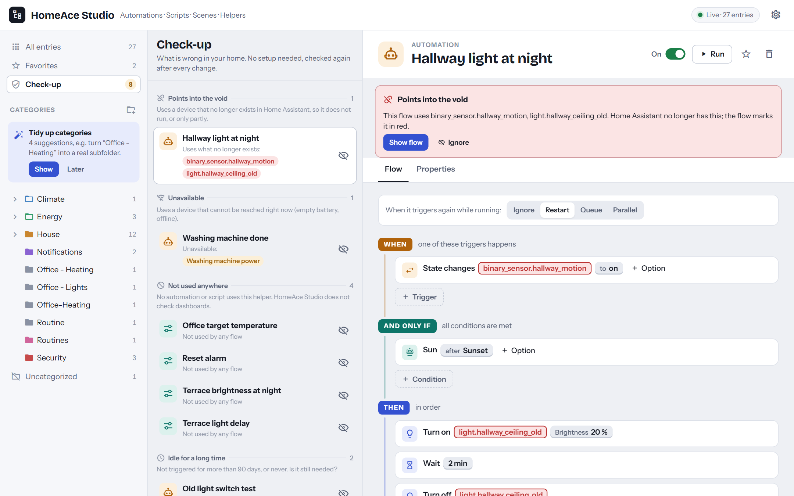
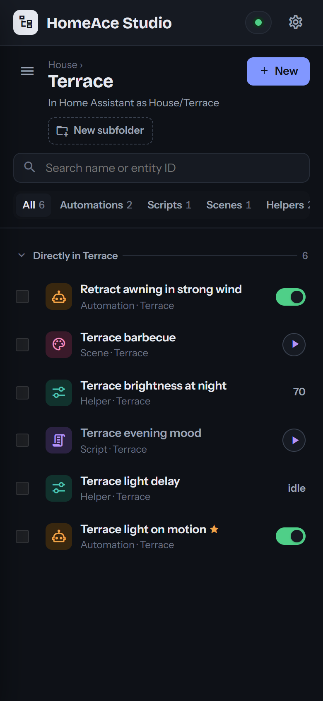
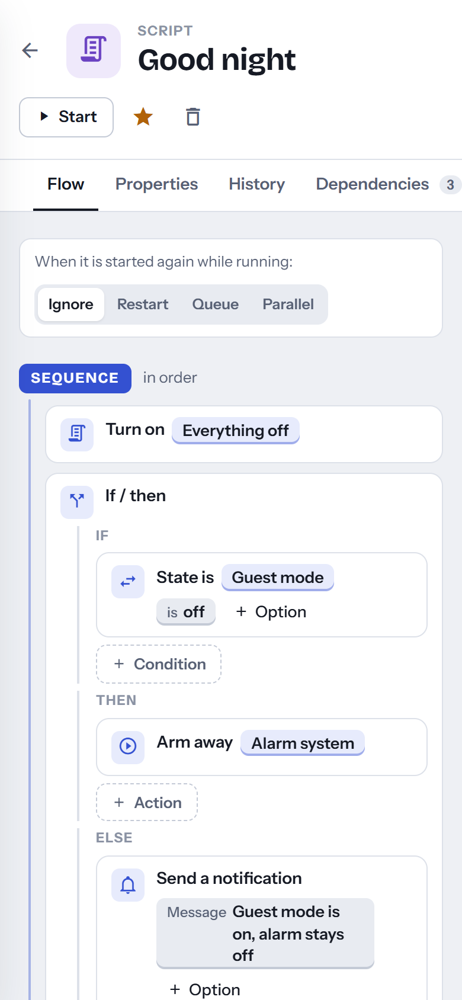

<h1 align="center"></h1>

**A calmer, clearer home for your Home Assistant automations, scripts, scenes and helpers.**
Real folders instead of one long list, flows you read like sentences, and no YAML in sight.



HomeAce Studio is a Home Assistant app (add-on). It works on top of what HA already stores:
your categories, entities and automations stay in Home Assistant and keep working without it.

> **Status: early preview.** It is used on its author's own Home Assistant, but it is young. Make a backup
> before you let it change things, and expect rough edges.

## What it does

**Folders that nest.** HA categories are flat. HomeAce Studio shows `House/Terrace` as a folder
inside `House`, in every scope at once, and stores it in HA as a normal category, so HA's own UI
still reads it. Drag entries onto folders, rename a folder with a preview of every HA category it
touches, and give folders colors that subfolders inherit.

**Flows as sentences.** Automations read as *When … / And only if … / Then …*, scripts as a
sequence. Tap any value to change it in a small editor made for its type (entity, state, number,
duration, time, option list). Add, move, duplicate, disable or delete blocks; nested *if / then*,
*choose*, *repeat* and *parallel* blocks are shown as such. Nothing reaches HA until you choose
*Save to HA*, and blocks it does not know yet survive a save untouched.



**Everything about an entry in one place.** Name, icon, area, labels, folder, on/off, run, notes
and favorites (the last two live only in HomeAce Studio). Create automations, scripts and eight
kinds of helpers in a few clicks; delete them again when they are not needed.



**Tidy up old categories.** Many homes fake subfolders with names like `Office - Heating`.
HomeAce Studio spots them, proposes real subfolders and merges near-duplicates such as `Routine`
and `Routines`. You tick every line yourself and see each change in Home Assistant before it
happens.



**Let an AI suggest a folder structure.** Switch on the optional AI access (MCP) and an assistant
such as Claude can read your folders and entries and send a plan: rename folders, sort entries
in. It cannot change anything itself. The plan waits in HomeAce Studio, you untick what you do not
want, check the preview and apply it. Flows, states and notes are never shown to the AI.



**Pick devices like a person, not like a database.** Choosing a light or sensor for a flow starts
with the room: pick an area, see its devices with their functions ("Front door sensor → Battery")
and their state right now, or search with words in any order. Filter by area, label or kind; the
devices the flow already uses come first. "All lights · Living room" targets the whole room,
including lights you add later.



**Check-up, no setup needed.** Even if you never sort anything, HomeAce Studio shows what needs a
look: automations that use devices which no longer exist (marked red in the flow) or are offline
right now, helpers no automation or script uses, and automations that have not run for months.
Ignore what is fine as it is.



**Made to be used everywhere.** Light and dark mode, German and English, all columns resizable,
and on a phone the list comes first and the details slide in full screen. Technical details such
as entity IDs stay hidden until you switch them on.

<p align="center">
  
  &nbsp;&nbsp;
  
</p>

**Live.** Changes made in HA show up right away, without reloading.

## Coming next

- Dependencies at a glance: what an automation uses, and what uses this helper.
- A view by area or device for homes without folders, and turning it into folders in one click.
- Run history, editing helper settings, scenes.
- A full visual blueprint editor: build blueprints from scratch or from any automation.

## Try it without Home Assistant

A demo mode runs the whole UI against an invented home kept in memory (Node.js 22 or newer):

```bash
cd frontend && npm install && npm run build
cd ../backend && npm install && npm run build
HOMEACE_DEMO=true PORT=3100 STATIC_DIR=../frontend/dist node dist/main.js
```

Then open <http://localhost:3100>. Everything works, nothing is saved. The screenshots above come
from this demo.

## Install on Home Assistant

HomeAce Studio needs Home Assistant OS or Supervised (the app store), on amd64 or aarch64
(Raspberry Pi 4/5, HA Green and Yellow).

[](https://my.home-assistant.io/redirect/supervisor_add_addon_repository/?repository_url=https%3A%2F%2Fgithub.com%2Fshadowtsw%2Fhomeace-studio)

1. Click the button above, or add the repository by hand: Settings → Apps → App store → ⋮ →
   Repositories → `https://github.com/shadowtsw/homeace-studio`.
2. Open **HomeAce Studio** in the app store, install and start it, and turn on **Show in sidebar**.

Updates arrive like for any other app. The app documentation explains the AI access:
[homeace-studio/DOCS.md](homeace-studio/DOCS.md).

## For developers

```text
frontend/        Vue 3 + TypeScript, own components, vue-i18n
backend/         NestJS; talks to HA over its WebSocket and REST APIs and serves the built UI
homeace-studio/  app definition for HA: config.yaml, Dockerfile, DOCS.md, CHANGELOG.md
scripts/         build-addon.mjs (assembles the app folder), screenshots.mjs (README pictures)
docs/            setup, architecture, API, decisions
```

Local development against a real HA, a local test environment (`node scripts/local.mjs`, or
`docker compose`), tests and the app build are described in
[docs/setup.md](docs/setup.md); the design is in [docs/architecture.md](docs/architecture.md).

## Support

HomeAce Studio is free and open source. If it saves you time, you can buy me a coffee:

<a href="https://ko-fi.com/gerrul3r"></a>
<a href="https://buymeacoffee.com/gerrul3r"></a>

## License

[MIT](LICENSE). HomeAce Studio is an independent project and not affiliated with Home Assistant or
Nabu Casa.
